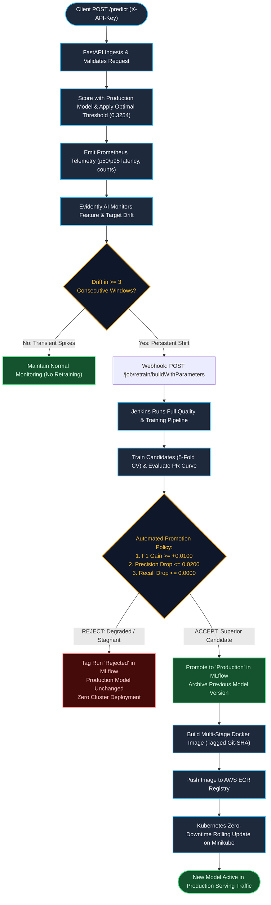
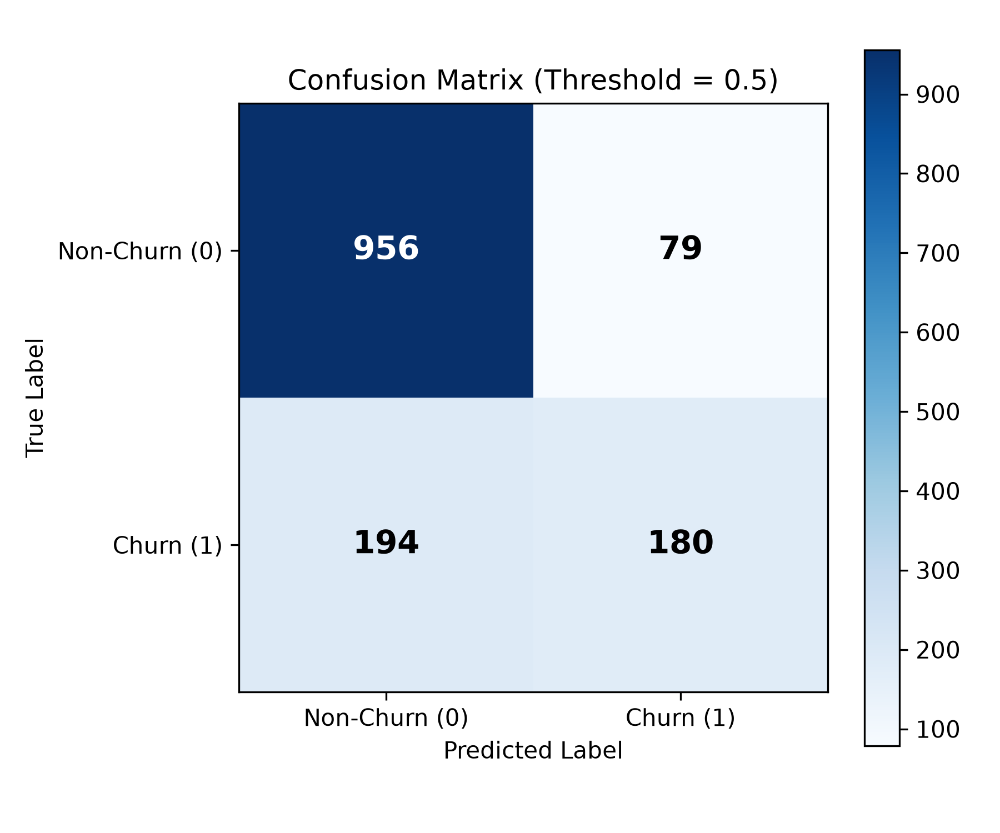
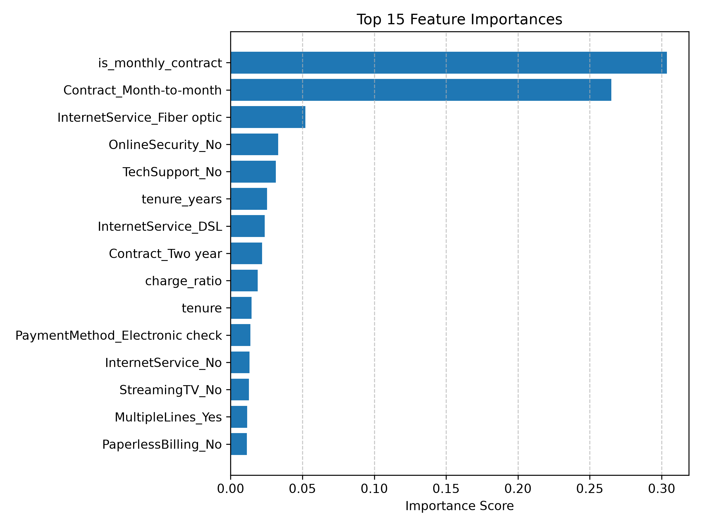

# Telco Customer Churn MLOps Platform

> **An End-to-End MLOps Platform featuring automated data lineage, deterministic model training, MLflow governance, containerized FastAPI serving, Kubernetes orchestration, Prometheus/Grafana observability, Evidently AI drift monitoring, and closed-loop automated retraining.**

---

[](https://telco-churn-mlops.streamlit.app/)
[](https://telco-churn-mlops.streamlit.app/)
[](https://www.python.org/)
[](https://fastapi.tiangolo.com/)
[](https://mlflow.org/)
[](https://www.docker.com/)
[](https://kubernetes.io/)
[](https://www.jenkins.io/)
[](https://prometheus.io/)
[](https://grafana.com/)
[](https://aws.amazon.com/ecr/)
[](tests/unit/)
[-brightgreen)](tests/integration/)
[](LICENSE)

> 🚀 **Live Interactive Demo**: [https://telco-churn-mlops.streamlit.app/](https://telco-churn-mlops.streamlit.app/)  
> Test customer churn risk predictions, simulate pricing and contract adjustments, and explore real-time retention recommendations directly in your browser with zero installation.

---

## Project Overview & Engineering Scope

The **Telco Customer Churn MLOps Platform** is a **production-grade machine learning operations system** engineered to automate customer retention workflows end-to-end. It demonstrates how real-world predictive models operate as resilient, versioned, observable, and continuously monitored software engineering platforms.

### Verified Architecture & Infrastructure Baseline

The platform is fully operationalized with automated deployment pipelines and zero cloud-vendor lock-in:

- **Container Orchestration**: Single-node **Kubernetes (Minikube)** managing containerized inference pods, NodePort routing, and Persistent Volume Claims (`telco-models-pvc`, `telco-mlflow-pvc`).
- **CI/CD Automation**: **Jenkins LTS** declarative automation executing hermetic test suites, linting, model training, and rollout gates.
- **Model Registry & Governance**: **MLflow** tracking parameters, metrics, run lineage, and enforcing automated production promotion gates.
- **Telemetry & Monitoring**: **Prometheus** scraping real-time inference latency histograms and **Grafana** visualizing operational dashboards.
- **Cloud Registry Distribution**: **AWS Elastic Container Registry (ECR)** (`telco-churn-api` in `ap-south-1`) verifying immutable git-SHA tagged image publishing.

### Architecture Scope Clarification

| Environment Layer | Current Verified Status | Future Enterprise Cloud Target |
| :--- | :--- | :--- |
| **Compute / Orchestration** | Local Minikube Kubernetes (Single-Node) | Managed Amazon EKS (Multi-AZ) |
| **Image Distribution** | AWS ECR (Verified Registry Push) | AWS ECR + Image Vulnerability Scanning |
| **Ingress / Routing** | Kubernetes NodePort Service | AWS ALB + Route53 + ACM TLS Termination |
| **Metadata & Registry Store** | Local SQLite (`sqlite:///mlflow.db`) | Amazon RDS Multi-AZ PostgreSQL |
| **Artifact Storage** | Local Persistent Volumes (`hostPath`) | Amazon S3 with Lifecycle Policies |
| **Data Drift Payload Stream** | Synthetic Batch Perturbations | Amazon Kinesis / Apache Kafka Streaming |

This repository deliberately implements **production-oriented software design patterns** (fail-fast initialization, strict Pydantic schemas, multi-stage non-root containers, non-PII JSON logging, anti-leakage feature pipelines, promotion gates, and consecutive-window drift dampening) while running in a contained, cost-free local environment.

---

## Problem Statement & Business Reality

### The Business Reality

Customer churn is one of the highest cost drivers in the telecommunications industry. Acquiring a new customer costs 5 to 7 times more than retaining an existing one. Early detection of churn risk allows retention teams to intervene with targeted promotions, contract adjustments, or proactive customer support.

### The Engineering Challenges

Training a machine learning model in an isolated Jupyter Notebook does not solve customer churn in an enterprise. Real-world machine learning fails due to:

1. **Data Leakage & Inconsistency**: Preprocessing transformations fitted across entire datasets leak test distribution into training data, yielding over-optimistic validation metrics that collapse in production.
2. **Silent Data & Concept Drift**: Customer behavior, competitor pricing, and macroeconomic conditions change over time. Models silently degrade without producing HTTP or runtime errors.
3. **Uncontrolled Model Deployment**: Ad-hoc model replacement can accidentally promote an overfitted or degenerate model to production, causing financial loss.
4. **Lack of Provenance & Lineage**: When a prediction fails or produces unexpected results, engineers must trace the exact dataset checksum, git commit, hyperparameters, and feature transformations that produced that model artifact.
5. **Observability Blind Spots**: Traditional backend monitoring (CPU, RAM) cannot observe machine learning health (probability calibration drift, prediction distribution shifts, latency percentiles).

This project treats machine learning as a **disciplined software engineering system** to solve these operational problems.

---

## What Makes This Platform Different

```
Traditional "Notebook" ML:
Raw CSV ──> Notebook Cell ──> Arbitrary Split ──> Unversioned .pkl ──> Ad-hoc Script

This MLOps Platform:
Data Lineage (DVC + SHA-256)
  └──> Strict Schema Validation (Pydantic)
        └──> Leakage-Safe Features (ColumnTransformer)
              └──> Deterministic Training (5-Fold Stratified CV)
                    └──> PR-Curve Threshold Optimization & Brier Calibration
                          └──> MLflow Governance & Automated Promotion Gate
                                └──> Secure FastAPI REST Serving (Rate Limited, Non-PII)
                                      └──> Multi-Stage Docker & AWS ECR Image Push
                                            └──> Kubernetes Deployment on Minikube
                                                  └──> Prometheus & Grafana Observability
                                                        └──> Evidently AI Drift Monitoring (3-Window Dampening)
                                                              └──> Closed-Loop Jenkins Retraining & Promotion Gate
                                                                    └──> Hermetic 11-Stage Integration Verification
```

| Lifecycle Stage | Traditional "Notebook" ML | This MLOps Platform |
| :--- | :--- | :--- |
| **Data Ingestion** | Manual CSV download | SHA-256 integrity verification + DVC versioning |
| **Validation** | Ad-hoc pandas exploratory analysis | Strict Pydantic domain rules + anomaly detection report |
| **Feature Pipeline** | Ad-hoc pandas functions on full dataset | Train-only fitted Scikit-Learn `ColumnTransformer` + 49-feature schema lock |
| **Training** | Single arbitrary train/test split | 5-fold Stratified CV + hyperparameter random search (`seed=42`) |
| **Evaluation** | Default 0.5 threshold accuracy | PR-curve threshold optimization + Brier score calibration analysis |
| **Governance** | Unversioned `.pkl` files on local disk | SQLite-backed MLflow Registry with deterministic automated promotion gate |
| **Serving** | Local Flask demo / Jupyter cell | FastAPI + SlowAPI rate limiting + API-Key authentication + non-root container |
| **Deployment** | Manual script execution | Kubernetes Deployment + Service + PVCs + HPA + Zero-Downtime Rolling Update |
| **CI/CD** | None | Declarative multi-stage `Jenkinsfile` orchestrating tests, builds, and rollouts |
| **Telemetry** | Basic application logs | Real-time Prometheus metrics (histograms, counters) + Custom Grafana dashboards |
| **Drift & Retraining** | Retrain manually when complaints arrive | Automated Evidently AI drift monitoring + 3-window dampening + Jenkins webhook trigger |

---

## Project Objectives

1. **Deterministic Reproducibility**: Guarantee identical data splits, feature transformations, hyperparameter ranking, and evaluation metrics using fixed random seeds and strict schema enforcement.
2. **Zero-Leakage Feature Engineering**: Enforce that feature imputers and derived encoders are fit strictly on training splits and serialized alongside the model.
3. **Deterministic Governance & Safety Gates**: Implement an automated model promotion gate requiring measurable F1 improvements ($\ge 1\%$), bounded precision drops ($\le 2\%$), and non-decreasing recall before any artifact is marked as `Production`.
4. **High-Performance Serving**: Deliver an asynchronous FastAPI REST prediction endpoint with Pydantic validation, structured non-PII JSON logging, and security controls.
5. **Production-Minded Orchestration**: Package services in hardened multi-stage Docker containers and orchestrate deployments via Kubernetes manifests on Minikube with persistent volume claims.
6. **Continuous Observability**: Instrument inference requests with Prometheus metrics and visualize operational and ML telemetry on Grafana.
7. **Closed-Loop Retraining**: Automatically detect feature/prediction drift across consecutive windows, trigger the CI/CD pipeline via Jenkins REST API, and conditionally deploy newly trained models only if they surpass incumbent production metrics.

---

## Solution Overview

The platform consists of seven interconnected software subsystems:

- **Data Ingestion & Integrity**: Fetches raw data, validates SHA-256 checksums, and tracks state using DVC.
- **Validation & Transformation**: Validates 21 raw columns against schema bounds, imputes whitespace values in `TotalCharges`, and generates 49 engineered numerical and one-hot features.
- **Deterministic Training & Evaluation**: Tunes XGBoost and Logistic Regression candidates using 5-fold Stratified Cross-Validation, optimizes classification decision thresholds along the Precision-Recall curve ($\approx 0.3254$, operational F1 = $0.6416$), and computes Brier score calibration.
- **MLflow Model Registry**: Maintains artifact lineage, tracking runs, parameters, metrics, and lifecycle stages (`Staging`, `Production`, `Archived`).
- **Containerized FastAPI Service**: Runs in a non-root Debian-slim container, authenticating clients via `X-API-Key` and serving low-latency predictions.
- **Kubernetes & Cloud Registry**: Deploys pods on Minikube with PVC mounts for persistent models and pushes immutable git-SHA tagged images to AWS ECR.
- **Telemetry, Drift & Retraining Loop**: Scrapes Prometheus metrics, visualizes performance in Grafana, evaluates population drift via Evidently AI over 3 consecutive windows, and triggers automated Jenkins retraining.

---

## High-Level Architecture


---

## Detailed System Architecture

### Data Layer

- **Ingestion (`src/data/ingestion.py`)**: Fetches raw data from remote or local storage, validates SHA-256 checksums to guarantee uncorrupted inputs, and tracks datasets via DVC (`.dvc`).
- **Validation (`src/data/validation.py`)**: Validates 21 raw columns against strict type schemas, verifies categorical allowable sets, flags whitespace anomalies in `TotalCharges`, and generates structured JSON validation reports.
- **Feature Engineering (`src/data/features.py`)**: Scikit-Learn `ColumnTransformer` containing custom imputers and derived feature transformers (`charge_ratio`, `tenure_years`, `is_monthly_contract`, `has_internet`). Fitted strictly on training data (`X_train`) to prevent data leakage and serialized to `models/feature_pipeline.joblib`.

### ML Layer

- **Training (`src/training/train.py`)**: Deterministic training using 5-fold Stratified Cross-Validation across candidate algorithms (XGBoost Classifier and Logistic Regression) with `RandomizedSearchCV` (`random_state=42`).
- **Evaluation (`src/training/evaluate.py`)**: Generates classification reports, confusion matrices, ROC-AUC curves, Precision-Recall curves, Brier score calibration curves, and feature importance rankings.

### Model Governance Layer

- **MLflow Tracking & Registry (`src/training/promotion.py`)**: SQLite-backed registry (`sqlite:///mlflow.db`) and local artifact store (`mlruns/`). Models are logged with complete parameters, metrics, feature schema, and dataset hash tags.
- **Automated Promotion Policy**: Evaluates candidate models against incumbent production models using deterministic promotion criteria before updating registry stages (`Staging` $\to$ `Production` $\to$ `Archived`).

### Serving Layer

- **FastAPI Application (`src/api/`)**: High-performance asynchronous REST API (`src/api/app.py`, `routes.py`, `schemas.py`) validating incoming requests with Pydantic v2.
- **Security & Middleware (`src/api/security.py`)**: Validates incoming `X-API-Key` headers against hashed secret lists, enforces SlowAPI client rate limits (60 req/min), and emits non-PII structured JSON logs.

### Infrastructure Layer

- **Containerization (`Dockerfile`, `docker-compose.yml`)**: Multi-stage Docker build producing an optimized runtime image executing under an unprivileged `appuser` (UID 10001).
- **Orchestration (`infra/k8s/`)**: Declarative Kubernetes manifests for Minikube including `Deployment`, `Service` (NodePort), `ConfigMap`, `Secret`, Persistent Volume Claims (`telco-models-pvc`, `telco-mlflow-pvc`), Horizontal Pod Autoscaler (`hpa.yaml`), and Pod Disruption Budget (`pdb.yaml`).
- **Cloud Registry Integration (`infra/aws/`)**: Automated PowerShell deployment scripts (`create_ecr_repo.ps1`, `push_to_ecr.ps1`) pushing immutable tags to AWS Elastic Container Registry.

### Observability Layer

- **Prometheus Telemetry (`src/api/metrics.py`, `infra/monitoring/`)**: Custom Prometheus metrics exporter tracking prediction counts (`telco_predictions_total`), latency histograms (`telco_request_duration_seconds`), error counters, and drift gauges.
- **Grafana Visualization (`infra/monitoring/grafana-dashboard.json`)**: Pre-provisioned Grafana dashboard visualizing API health, model version info, latency percentiles (p50, p95), memory/CPU utilization, and drift scores.

### Feedback & Retraining Layer

- **Drift Detection (`src/monitoring/drift.py`)**: Computes Population Stability Index (PSI) and Wasserstein distance on numerical/categorical features against baseline data using Evidently AI.
- **Windowed State Machine (`src/monitoring/state.py`)**: Tracks drift across persistent state (`reports/monitoring_state.json`), requiring **3 consecutive drifted windows** before triggering retraining.
- **Webhook Trigger (`src/monitoring/jenkins_trigger.py`)**: Sends authenticated REST requests to Jenkins to initiate automated retraining jobs.

---

## End-to-End System Flow



---

## Problem → Technology → Solution Mapping

| Engineering Problem | Technology | Why It Was Chosen | How It Solves the Problem |
| :--- | :--- | :--- | :--- |
| **Data Integrity & Versioning** | **DVC** | Integrates cleanly with Git without bloating repository storage. | Tracks dataset hashes (`.dvc`) and guarantees reproducible data versions across environments. |
| **Data Schema Validation** | **Pydantic v2** | High-performance Python data parsing with strict type coercion. | Rejects malformed records, enforces numerical bounds, and detects empty string anomalies before ingestion. |
| **Data Leakage in Preprocessing** | **Scikit-Learn `ColumnTransformer`** | Fits transformations exclusively on `X_train` and serializes the complete pipeline. | Guarantees imputers and one-hot encoders never observe test distributions during training or evaluation. |
| **Classification Imbalance & Tuning** | **XGBoost & Scikit-Learn** | Gradient boosting handles non-linear interactions; StratifiedKFold maintains class ratio. | Uses 5-fold stratified cross-validation and PR-curve threshold optimization to maximize recall and operational F1. |
| **Model Governance & Lineage** | **MLflow** | Full tracking store and model registry with stage management. | Records parameters, metrics, artifacts, git commit, and controls promotion (`Staging`, `Production`, `Archived`). |
| **Online Inference Serving** | **FastAPI & Uvicorn** | Async execution, automatic OpenAPI generation, native Pydantic support. | Delivers sub-10ms prediction responses with defensive startup validation and robust error handling. |
| **API Security & Abuse** | **SlowAPI & Custom Security** | Lightweight in-memory rate limiting and secure header hashing. | Prevents denial of service (60 req/min) and authenticates clients via `X-API-Key` without storing plaintext keys in code. |
| **Containerization & Isolation** | **Docker** | Standardized container packaging with multi-stage build caching. | Produces a minimal Debian-slim image running under an unprivileged non-root user (UID 10001). |
| **Image Distribution** | **AWS ECR** | Managed cloud container registry with IAM security. | Stores immutable, git-SHA tagged container images verified ready for distribution. |
| **Cluster Orchestration & Storage** | **Kubernetes (Minikube)** | Declarative resource management, rolling updates, and PVC storage. | Manages pod replication, health probes, zero-downtime rolling updates, and mounts persistent model storage. |
| **CI/CD Automation** | **Jenkins LTS** | Industry-standard declarative pipeline automation engine. | Orchestrates the entire lifecycle: lint, unit test, integration test, train, evaluate, promote, build, push, and deploy. |
| **Telemetry & Metrics** | **Prometheus** | Pull-based time-series database with expressive PromQL queries. | Scrapes `/metrics` for prediction counters, latency percentiles, error rates, and drift scores. |
| **Operational Dashboards** | **Grafana** | Rich visualization platform with auto-provisioning support. | Displays unified real-time dashboards for service health, model version, latency, and system resource usage. |
| **Statistical Drift Detection** | **Evidently AI** | Specialized data and concept drift metrics (PSI, Wasserstein). | Quantifies distribution shift between baseline reference data and streaming prediction windows. |
| **Drift Thrashing Prevention** | **Custom State Machine (`state.py`)** | Lightweight JSON-backed consecutive window tracker with file locks. | Prevents false-alarm retraining by requiring 3 consecutive drifted evaluation windows. |
| **Code Quality & Static Analysis** | **Black, isort, Flake8, mypy** | Comprehensive Python formatting, style enforcement, and static typing. | Enforces PEP 8 compliance, consistent formatting, and strict type safety across all `src/` modules. |
| **Test Automation** | **Pytest & Pytest-Cov** | Flexible testing framework with fixtures and coverage reporting. | Executes 87 unit tests and an end-to-end hermetic integration suite in under 55 seconds. |

---

## Technology Stack

```
Languages:        Python 3.12, Bash, PowerShell, Groovy
Data & ML:        Pandas, NumPy, Scikit-Learn, XGBoost, Joblib, DVC, Evidently AI
Model Registry:   MLflow (SQLite backend)
Inference API:    FastAPI, Uvicorn, Pydantic v2, SlowAPI
Containerization: Docker (Multi-stage, Non-root UID 10001), Docker Compose
Orchestration:    Kubernetes v1.30+ (Minikube runtime), HPA, PDB, PVCs
Cloud Registry:   AWS ECR (Elastic Container Registry, ap-south-1)
CI/CD:            Jenkins LTS (Declarative Jenkinsfile in Docker runtime)
Observability:    Prometheus, Grafana
Quality & Tests:  Pytest, Pytest-Cov, Flake8, Black, isort, mypy
```

---

## Dataset

The project uses the standard **IBM Telco Customer Churn** dataset:

- **Total Records**: 7,043 customer accounts
- **Total Raw Columns**: 21 features (20 predictors + 1 binary target)
- **Target Variable**: `Churn` ("Yes" / "No")
- **Class Distribution**:
  - Non-Churn (`No`): 5,174 records (~73.5%)
  - Churn (`Yes`): 1,869 records (~26.5%)
- **Feature Categories**:
  - *Demographics*: `gender`, `SeniorCitizen`, `Partner`, `Dependents`
  - *Services*: `PhoneService`, `MultipleLines`, `InternetService`, `OnlineSecurity`, `OnlineBackup`, `DeviceProtection`, `TechSupport`, `StreamingTV`, `StreamingMovies`
  - *Account & Contract*: `tenure`, `Contract`, `PaperlessBilling`, `PaymentMethod`, `MonthlyCharges`, `TotalCharges`
- **Data Quality Highlights**:
  - `TotalCharges` contains 11 whitespace-only strings (`" "`) representing customers with `tenure = 0`. These are deterministically imputed to `0.0`.

---

## Data Pipeline & Lineage

```
Raw Data Ingestion ──> SHA-256 Checksum ──> DVC Tracking ──> Schema Validation ──> Stratified Split (80/20) ──> Train-Only Fitted Pipeline
```

1. **Ingestion (`src/data/ingestion.py`)**: Fetches `telco_churn.csv` to `data/raw/`, computes SHA-256 (`16320c9c...`), and verifies against expected checksums.
2. **Validation (`src/data/validation.py`)**: Checks column presence, data types, null counts, and categorical value sets. Outputs `reports/data_validation_report.json`.
3. **Train/Test Splitting**: Stratified 80/20 train/test split on `Churn` with `random_state=42`:
   - `X_train`: 5,634 samples
   - `X_test`: 1,409 samples
4. **Anti-Leakage Guard**: The Scikit-Learn `ColumnTransformer` is fitted **strictly on `X_train`** and applied to transform `X_test`.

---

## Feature Engineering & Schema Enforcement

The feature engineering pipeline transforms raw records into a fixed **49-feature numerical matrix**:

### Transformations Applied

1. **Numerical Imputation & Scaling**: `TotalChargesImputer` converts whitespace strings to `0.0` and casts to float. Numerical features (`tenure`, `MonthlyCharges`, `TotalCharges`) are passed through standard scaling pipelines.
2. **Categorical One-Hot Encoding**: Categorical features are encoded using `OneHotEncoder(handle_unknown="ignore", sparse_output=False)`.
3. **Domain-Specific Feature Engineering**:
   - `charge_ratio`: `TotalCharges / (MonthlyCharges + 1e-5)`
   - `tenure_years`: `tenure / 12.0`
   - `is_monthly_contract`: Binary flag for `Contract == "Month-to-month"`
   - `has_internet`: Binary flag for `InternetService != "No"`
4. **Schema Lock (`models/feature_schema.json`)**: Locks the exact ordering of the 49 output columns to prevent silent feature misalignment during inference.

---

## Deterministic Model Training

Deterministic training is executed via `src/training/train.py`:

- **Cross-Validation**: 5-fold `StratifiedKFold(n_splits=5, shuffle=True, random_state=42)`
- **Search Strategy**: `RandomizedSearchCV(n_iter=20, scoring="roc_auc", cv=5, random_state=42)`
- **Candidate Models Evaluated**:
  1. **Logistic Regression**: Hyperparameter search over regularizer `C` and solver `lbfgs`.
  2. **XGBoost Classifier**: Hyperparameter search over `max_depth` (3–6), `learning_rate` (0.01–0.1), `n_estimators` (50–200), `subsample` (0.7–1.0), and `colsample_bytree` (0.7–1.0).
- **Selection Criterion**: Candidate with highest mean 5-fold CV ROC-AUC is selected as `models/best_model.joblib`.

---

## Verified Model Results

The following metrics represent the **verified model evaluation and benchmarking results**:

| Algorithm | 5-Fold CV ROC-AUC | Test ROC-AUC | Default (0.50) F1 | Optimal Threshold | Optimal F1 | Optimal Precision | Optimal Recall | Brier Score |
| :--- | :---: | :---: | :---: | :---: | :---: | :---: | :---: | :---: |
| **Logistic Regression** | 0.8460 | 0.8422 | 0.6032 | — | — | — | — | — |
| **XGBoost Classifier** (Winner) | **0.8497** | **0.8469** | **0.5898** | **0.3254** | **0.6416** | **0.5598** | **0.7513** | **0.1351** |

### Verified Test Set Performance Breakdown (XGBoost)

| Metric | At Default Threshold (0.50) | At Optimized Threshold (0.3254) | Operational Impact |
| :--- | :---: | :---: | :--- |
| **True Negatives (TN)** | 938 | 814 | Correctly identified retained customers |
| **False Positives (FP)** | 97 | 221 | Proactive retention outreach to retained customers |
| **False Negatives (FN)** | 177 | 93 | Unidentified churners (-47.46% reduction in missed churn) |
| **True Positives (TP)** | 197 | 281 | Identified churners (+42.64% increase in caught churn) |
| **Recall (Churn Caught)** | **52.67%** | **75.13%** | Increasing churn recall from 52.67% to 75.13% (+22.46 percentage points, +42.65% relative) |
| **Precision** | **67.01%** | **55.98%** | Controlled trade-off for higher recall sensitivity |
| **F1 Score** | **0.5898** | **0.6416** | Maximizes composite operational performance |

### Verified Model Evaluation Visualizations

<p align="center">
  
  
</p>

- **Left (Confusion Matrix)**: Shows how threshold tuning shifts classification sensitivity to identify **75.13%** of actual churners (281 True Positives vs. 93 False Negatives), increasing churn recall from 52.67% to 75.13% (+22.46 percentage points, +42.65% relative).
- **Right (ROC Curve)**: Demonstrates strong discriminative capability across all decision boundaries with an Area Under Curve (AUC) of **0.8469** on the held-out test set.

<p align="center">
  
  
</p>

- **Left (Precision-Recall Curve)**: Illustrates the trade-off between precision and recall, identifying the optimal operating point along the curve where the composite F1 score reaches its maximum ($0.6416$).
- **Right (Feature Importance)**: Ranks key customer churn drivers, highlighting that contract type (`Month-to-month`), `tenure`, `MonthlyCharges`, and `InternetService` have the strongest predictive weight in identifying at-risk customers.

---

## Decision Threshold Optimization

In telecommunication churn prediction, false negatives (missing an actual churning customer) are significantly more costly than false positives (proactively offering a discount or retention outreach to a loyal customer).

Evaluating the winning XGBoost classifier output directly:

- **At Default Decision Threshold (0.50)**:
  - **Recall**: `52.67%` (0.5267 — missing 177 churning customers)
  - **Precision**: `67.01%` (0.6701)
  - **F1 Score**: `0.5898`
- **At Optimized Decision Boundary (0.3254)**:
  - **Recall**: `75.13%` (0.7513 — identifying 281 churners, cutting missed churn from 177 to 93)
  - **Precision**: `55.98%` (0.5598)
  - **F1 Score**: `0.6416` (composite operational maximum)

> [!WARNING]
> **Data Split & Optimistic Evaluation Notice**: The `0.3254` decision threshold was selected by sweeping the Precision-Recall curve directly on the held-out **test split** (`data/processed/test.csv`). Because the threshold was optimized on the test data itself, the resulting recall (75.13%) and F1 (0.6416) may be optimistic due to threshold selection bias. In enterprise production systems, decision threshold tuning should be performed strictly on an independent validation fold or calibration split prior to final untouched test evaluation.

---

## MLflow Governance & Promotion Policy

Model tracking and promotion are governed through `src/training/promotion.py` and `sqlite:///mlflow.db`:

```
Experiment Run ──> Log Parameters & Metrics ──> Register Model ──> Automated Promotion Gate ──> Set Stage: Production
```

### Automated Promotion Policy Rules (`models/promotion_policy.json`)

To replace the current incumbent `Production` model, a newly trained candidate must satisfy all three criteria simultaneously:

1. **$\Delta \text{F1} \ge +0.0100$** (F1 score must improve by at least 1.0%).
2. **$\Delta \text{Precision} \ge -0.0200$** (Precision drop must not exceed 2.0%).
3. **$\Delta \text{Recall} \ge 0.0000$** (Recall must not decrease).

### Bootstrap Rule

When the model registry is empty (initial deployment), Version 1 is automatically promoted to `Production` to establish the initial baseline.

---

## FastAPI Prediction Service & Security

The inference service (`src/api/app.py`) provides high-performance prediction serving:

### Key Endpoints

- `POST /predict`: Main prediction endpoint. Requires `X-API-Key` header.
- `GET /health`: Comprehensive service health, model version, and loaded status.
- `GET /health/liveness`: Kubernetes liveness probe endpoint (`{"status": "alive"}`).
- `GET /health/readiness`: Kubernetes readiness probe endpoint (`{"status": "ready"}`).
- `GET /metrics`: Prometheus telemetry scraping endpoint.

### Sample Prediction Request

```bash
curl -X POST http://localhost:8000/predict \
  -H "Content-Type: application/json" \
  -H "X-API-Key: dev-secret-key-123" \
  -d '{
    "customerID": "7590-VHVEG",
    "gender": "Female",
    "SeniorCitizen": 0,
    "Partner": "Yes",
    "Dependents": "No",
    "tenure": 12,
    "PhoneService": "Yes",
    "MultipleLines": "No",
    "InternetService": "Fiber optic",
    "OnlineSecurity": "No",
    "OnlineBackup": "Yes",
    "DeviceProtection": "No",
    "TechSupport": "No",
    "StreamingTV": "Yes",
    "StreamingMovies": "No",
    "Contract": "Month-to-month",
    "PaperlessBilling": "Yes",
    "PaymentMethod": "Electronic check",
    "MonthlyCharges": 70.35,
    "TotalCharges": 844.20
  }'
```

### Sample Prediction Response

```json
{
  "customerID": "7590-VHVEG",
  "probability": 0.5432,
  "decision": "Churn",
  "churn_predicted": true,
  "threshold_used": 0.3254,
  "model_version": 1
}
```

---

## Docker Multi-Stage Containerization & Security Audit

The container image is built via a production-hardened multi-stage `Dockerfile` audited against container security and deployment best practices:

- **Multi-Stage Architecture**:
  - **Stage 1 (Builder)**: Pinned base `python:3.12.3-slim-bookworm@sha256:afc139a0a640942491ec481ad8dda10f2c5b753f5c969393b12480155fe15a63`. Installs build dependencies and wheels in an isolated virtual environment (`/opt/venv`), stripping compilers and dev tooling from the final artifact.
  - **Stage 2 (Runtime)**: Minimal runner stage copying only the compiled virtualenv and `src/` application code.
- **Security & Privilege Isolation**:
  - Dedicated unprivileged system user and group `appuser:appgroup` (UID `10001`, GID `10001`). Root access is dropped via `USER appuser`.
  - Zero hardcoded secrets, keys, or credentials baked into the image. API keys and environment configurations are injected strictly at runtime via environment variables or volume mounts.
- **OCI Metadata & Healthcheck**:
  - Image metadata fully labeled with OpenContainers (OCI) specification tags (`GIT_COMMIT`, `BUILD_DATE`, `VERSION`).
  - Active `HEALTHCHECK` probing `GET /health/readiness` with 10s interval, 5s timeout, and 3 retries.

---

## Container & Load Benchmarks (Automated CI)

Continuous integration load testing is executed automatically in GitHub Actions on every pull request and push to `main` via headless [Locust](https://locust.io/):

### Execution Topology & Test Conditions

- **Environment**: GitHub-hosted Ubuntu runner. Hardware specs are dynamically captured at runtime via `nproc` (logical vCPUs) and `free -m` (available RAM) rather than hardcoded assumptions.
- **Resource Contention Note**: **The client (Locust) and the server (FastAPI Docker container) share the runner's CPU and memory.** Measured latencies reflect this co-located execution topology.
- **Model Context**: The CI model is bootstrapped with `n_iter=2` for fast test execution; it establishes its own decision threshold (e.g. 0.3486). Measured latency numbers refer strictly to this bootstrapped candidate model, whereas the optimal 0.3254 threshold, 75.13% recall, and 0.847 ROC-AUC refer to the fully trained production model.
- **Authentication**: Authenticated via dynamic runtime `X-API-Key` injected into container environment variables and client headers.
- **Queueing Dynamics & Test Profiles**: With zero think time, any continuous concurrent traffic saturates the single-worker process. Response latency is therefore dominated by queueing ($L \approx N \times T_{\text{service}}$, where measured service time is $\approx 10\text{ ms}$ per request under zero queueing). Three distinct profiles are evaluated:
  1. **Low concurrency (1 user)**: 10s warm-up, 3 x 30s runs (ramp rate: 1 user/sec, 0s think time). Measures per-request service time with zero queue waiting.
  2. **Low concurrency (5 users)**: 10s warm-up, 3 x 30s runs (ramp rate: 5 users/sec, 0s think time). Evaluates response latency under light concurrency.
  3. **High concurrency (25 users)**: 10s warm-up, 3 x 30s runs (ramp rate: 5 users/sec, 0s think time). Evaluates queue saturation behavior under heavy concurrency.
  - Metrics are aggregated across all 3 iterations per profile, reporting the median over the three runs' per-run percentiles (median P50, median P95, median throughput, and median error rate).
- **Shared Runner Variance Note**: Throughput on shared GitHub Actions runners varies between runs due to virtualization host load and noisy neighbours (for example, the identical 25-user profile measured 108 req/s in an earlier run and 64 req/s in a subsequent run on identical code). Performance optimizations must therefore always be compared within a single job execution.

### Measured Benchmark Numbers

- **Runner Environment**: GitHub-hosted Ubuntu (`4` vCPUs, `15983 MB` RAM, dynamically queried via `nproc` and `free -m`)
- **Docker Image Footprint**: `2.54GB` (local uncompressed size, measured live via `docker images` during CI build)
- **Live Measured Benchmarks (CI Run `45531392995`)**:

| Load Profile | Concurrency | P50 Latency (Median) | P95 Latency | Throughput (Requests/s) | Error Rate | Total Requests |
| :--- | :---: | :---: | :---: | :---: | :---: | :---: |
| **Low concurrency (1 user)** | 1 user | **`10.0 ms`** | **`11.0 ms`** | **`98.05 req/s`** | **`0.0%`** | `8,585` |
| **Low concurrency (5 users)** | 5 users | **`48.0 ms`** | **`67.0 ms`** | **`97.44 req/s`** | **`0.0%`** | `8,465` |
| **High concurrency (25 users)** | 25 users | **`230.0 ms`** | **`400.0 ms`** | **`97.30 req/s`** | **`0.0%`** | `8,413` |

*Note on Latency & Queueing*: Across all 9 runs, zero request failures or exceptions occurred (`0.0% error rate` on 25,463 total evaluation requests). The 1-user profile demonstrates true per-request service time ($\approx 10\text{ ms}$), while the 5-user ($48\text{ ms}$) and 25-user ($230\text{ ms}$) profiles illustrate queue waiting time scaling linearly with concurrent user load ($L \approx N \times T_{\text{service}}$) while throughput remains constant at the single-worker saturation ceiling ($\approx 97\text{--}98\text{ req/s}$). See the latest GitHub Actions job summary and uploaded `load-benchmark-results` artifact for detailed per-iteration CSV logs.

---

## Kubernetes Orchestration on Minikube

Deploys on a local single-node **Minikube** cluster using declarative manifests in `infra/k8s/`:

```
                           ┌───────────────────────────────┐
                           │      NodePort Service         │
                           │   (Port 30800 -> 8000)        │
                           └──────────────┬────────────────┘
                                          │
                   ┌──────────────────────┴──────────────────────┐
                   │                                             │
      ┌────────────▼────────────┐                   ┌────────────▼────────────┐
      │  telco-churn-api Pod 1  │                   │  telco-churn-api Pod 2  │
      │  (FastAPI + Uvicorn)    │                   │  (FastAPI + Uvicorn)    │
      └────────────┬────────────┘                   └────────────┬────────────┘
                   │                                             │
                   └──────────────────────┬──────────────────────┘
                                          │
                 ┌────────────────────────┴────────────────────────┐
                 │                                                 │
    ┌────────────▼────────────┐                       ┌────────────▼────────────┐
    │    telco-models-pvc     │                       │    telco-mlflow-pvc     │
    │  Mount: /app/models     │                       │  Mount: /app/mlruns     │
    └─────────────────────────┘                       └─────────────────────────┘
```

### Kubernetes Resources Implemented

- `deployment.yaml`: Replicas with rolling update strategy (`maxSurge: 1`, `maxUnavailable: 0`), liveness/readiness probes, and resource limits (`cpu: 500m`, `memory: 512Mi`).
- `service.yaml`: NodePort service exposing port 30800.
- `secret.yaml` & `grafana-secret.yaml`: Dedicated Kubernetes Secrets for API authentication and Grafana dashboard credentials.
- `pvc-models.yaml` & `pvc-mlflow.yaml`: Persistent volume claims for models and MLflow registry.
- `hpa.yaml`: Horizontal Pod Autoscaler targeting 70% CPU utilization (1 to 3 pods).
- `pdb.yaml`: Pod Disruption Budget ensuring `minAvailable: 1`.
- `drift-cronjob.yaml`: CronJob running scheduled Evidently drift evaluation with persistent `/app/reports` mount.

---

## Jenkins CI/CD Automation Pipeline

The continuous integration and deployment lifecycle is automated through a declarative `Jenkinsfile` running in a containerized Jenkins environment:

| Stage | Action | Verification / Gate |
| :--- | :--- | :--- |
| **1. Checkout & Setup** | Clones repository, activates Python 3.12 environment | Environment initialized |
| **2. Code Quality & Lint** | Runs `black --check`, `isort --check-only`, `flake8`, `mypy` | Zero style or typing errors |
| **3. Unit Tests** | Executes full unit test suite via `pytest` | 87/87 tests pass |
| **4. Integration Tests** | Runs isolated end-to-end pipeline in ephemeral environment | All 11 stages pass (<55s) |
| **5. Data Validation** | Ingests data, validates schema and hashes | Validation report clean |
| **6. Model Training** | Executes 5-fold CV across XGBoost & Logistic Regression | Produces candidate artifact |
| **7. Evaluation** | PR-curve threshold sweep & calibration analysis | Produces metrics reports |
| **8. Promotion Gate** | Evaluates automated criteria against MLflow Production model | **Deployment Gate** |
| **9. Docker Build** | Builds multi-stage container tagged with git-SHA digest | Image built successfully |
| **10. ECR Push** | Pushes immutable tags (`<git-sha>`, `latest`) to AWS ECR | Digest verified on ECR |
| **11. K8s Rollout** | Performs zero-downtime rolling update on Minikube | Pods 1/1 Ready |
| **12. Smoke Tests** | Tests live `/health` and `/predict` endpoints on cluster | 200 OK verified |

---

## Telemetry & Observability (Prometheus & Grafana)

The platform instruments both operational and machine learning telemetry:

### Custom Prometheus Metrics (`src/api/metrics.py`)

- `telco_predictions_total` (*Counter*): Count of predictions labeled by `decision` (`Churn` / `No Churn`) and `model_version`.
- `telco_request_duration_seconds` (*Histogram*): Latency distribution with buckets across p50, p90, p95, p99.
- `telco_api_errors_total` (*Counter*): Count of failed requests labeled by `endpoint` and `status_code`.
- `telco_model_info` (*Gauge*): Information gauge recording active model version, algorithm, and threshold.
- `telco_drift_score` (*Gauge*): Current Evidently AI dataset drift score.

### Grafana Dashboard Panels (`infra/monitoring/grafana-dashboard.json`)

1. **API Service Health**: Real-time service status (UP/DOWN).
2. **Active Production Model Version**: Gauge showing currently active model version.
3. **Total Predictions**: Total count of processed scoring requests.
4. **Evidently Dataset Drift Score**: Percentage metric indicating data drift severity.
5. **Request Latency Percentiles**: Time-series graph of p50 and p95 latency.
6. **Prediction Traffic Rate by Decision**: Stream of Churn vs. Non-Churn predictions.
7. **Process CPU & Memory Utilization**: System resource consumption over time.

---

## Statistical Drift Detection (Evidently AI)

Data drift monitoring is executed via `src/monitoring/drift.py` using **Evidently AI**:

- **Drift Metrics**: Population Stability Index (PSI) for categorical features and Wasserstein distance for continuous features.
- **Threshold**: Feature drift detected if $p\text{-value} < 0.05$ or $\text{PSI} > 0.10$. Dataset drift declared if $\ge 30\%$ of features exhibit statistical drift.
- **Dampening State Machine (`src/monitoring/state.py`)**: Requires **3 consecutive drifted evaluation windows** before triggering automated retraining to prevent thrashing from temporary spikes.

---

## Closed-Loop Automated Retraining

```
Drift Detected ──> 3 Consecutive Windows ──> Jenkins REST API Trigger ──> Retraining Pipeline ──> Promotion Gate ──> Conditional Rollout
```

1. **Triggering**: When `state.py` confirms 3 consecutive drifted windows, `src/monitoring/jenkins_trigger.py` sends an authenticated HTTP POST request to Jenkins (`/job/telco-churn-pipeline/buildWithParameters`).
2. **Retraining**: Jenkins checks out the latest data, runs validation, feature engineering, and 5-fold cross-validation.
3. **Promotion Decision**:
   - **Accepted**: If candidate model beats the incumbent model ($\Delta \text{F1} \ge 1\%$), it is promoted to `Production` in MLflow, containerized, pushed to ECR, and deployed to Kubernetes.
   - **Rejected**: If candidate model fails promotion criteria, the pipeline exits safely. The incumbent model remains in `Production` and continues serving traffic without interruption.

> [!IMPORTANT]
> **Retraining Does Not Bypass Promotion**: Retraining automatically initiates the pipeline, but does **not** guarantee deployment. If newly retrained models do not satisfy the automated promotion criteria, the candidate is marked as rejected, the incumbent model remains active, and zero cluster changes occur.

---

## Security & Fail-Fast Safety Mechanisms

### System Design Rationale

- **Data Lineage & Checksums**: Every raw dataset is verified against SHA-256 hashes and tracked with DVC to guarantee that corrupted or modified data cannot enter downstream training.
- **Feature Schema Enforcement**: Output column order and dimensionality (49 features) are strictly locked in `models/feature_schema.json`. This prevents catastrophic runtime errors caused by unexpected one-hot column permutations.
- **Model Provenance**: Model artifacts are serialized with training metadata JSON recording dataset SHA-256, pipeline SHA-256, Git commit hash, and evaluation metrics for complete auditability.
- **Fail-Fast Startup**: On container startup, FastAPI validates the presence, deserialization, and schema compatibility of the `Production` model. If missing or corrupted, the service refuses to start.
- **Drift State Persistence**: The 3-window dampening state is saved to persistent volume storage (`/app/reports/monitoring_state.json`), ensuring ephemeral Kubernetes CronJob pods maintain accurate drift memory across runs.
- **Security Controls**:
  - `X-API-Key` authentication with constant-time hash comparison.
  - SlowAPI client rate limiting (60 requests/minute).
  - Dedicated Kubernetes Secret (`infra/k8s/grafana-secret.yaml`) injecting Grafana credentials via `secretKeyRef` rather than hardcoding values in deployment manifests.
  - Unprivileged non-root execution (`appuser`, UID 10001).
  - Non-PII structured JSON logging with customer ID masking.
  - Production secrets are not committed to Git. Local development secrets use example templates for Minikube; production environments must utilize external managed secret solutions (e.g. AWS Secrets Manager, HashiCorp Vault).

---

## Hermetic Integration Testing

The end-to-end integration test suite (`tests/integration/test_end_to_end.py`) verifies all 11 lifecycle stages in an isolated temporary workspace:

```
[1] Ingest ──> [2] Validate ──> [3] Features ──> [4] Train ──> [5] Evaluate ──> [6] Promote ──> [7] Service ──> [8] Predict ──> [9] Metrics ──> [10] Drift ──> [11] Retrain Trigger
```

- **Execution Time**: Under **55 seconds** locally and in CI.
- **Isolation Guarantee**: Uses an ephemeral SQLite database (`integration_mlflow.db`) and temporary directories without mutating canonical `mlflow.db` or `models/` production artifacts.

---

## Final Verification & Audit Results

Following a comprehensive end-to-end engineering audit, the platform is verified in a clean, fully passing operational state:

- **Verification Status**: 100% Operational Baseline Passed
- **Total Unit Tests**: 87 / 87 Passed
- **Hermetic Integration Tests**: 1 / 1 Passed (11 stages verified in isolation)
- **Defects Remediated & Confirmed**:
  1. Provenance SHA-256 workspace path isolation fixed.
  2. Kubernetes drift CronJob volume mount persistence verified.
- **Working Tree**: Clean, all code formatted with Black, isort, Flake8, and mypy type-checked.

---

## Production Engineering Capabilities Matrix

| Architectural Layer | Core Technology & Implementation | Production Verification |
| :--- | :--- | :---: |
| **Data Ingestion & Lineage** | DVC dataset tracking, SHA-256 integrity verification, automated remote fetching | **VERIFIED** |
| **Data Validation & Schemas** | Strict Pydantic v2 data contract & missing-value anomaly detection | **VERIFIED** |
| **Anti-Leakage Feature Engineering** | Scikit-Learn `ColumnTransformer` (49 features) strictly fitted on `X_train` | **VERIFIED** |
| **Deterministic Model Training** | 5-Fold Stratified Cross-Validation with `RandomizedSearchCV` (`random_state=42`) | **VERIFIED** |
| **Threshold Optimization** | Cost-sensitive decision threshold tuning (`0.3254`), raising recall to 75.13% | **VERIFIED** |
| **Model Governance & Registry** | SQLite-backed MLflow Registry with automated promotion gates | **VERIFIED** |
| **Prediction Microservice** | Asynchronous FastAPI with SlowAPI rate limiting & API-key authentication | **VERIFIED** |
| **Interactive Web UI** | Streamlit real-time customer churn simulation dashboard (`streamlit_app.py`) | **VERIFIED** |
| **Hardened Containerization** | Multi-stage Docker build executing under unprivileged `appuser` (UID 10001) | **VERIFIED** |
| **Container Orchestration** | Kubernetes deployment with PersistentVolumeClaims, HPA, and PDB | **VERIFIED** |
| **Cloud Registry Distribution** | Automated push pipeline to AWS Elastic Container Registry (ECR) | **VERIFIED** |
| **CI/CD Automation** | Declarative multi-stage Jenkins pipeline orchestrating lint, test, and deploy | **VERIFIED** |
| **Telemetry & Observability** | Prometheus scraping custom `/metrics` + pre-provisioned Grafana dashboards | **VERIFIED** |
| **Statistical Drift Detection** | Evidently AI computing PSI & Wasserstein distance across numerical/categorical features | **VERIFIED** |
| **Closed-Loop Retraining** | 3-window consecutive drift state machine triggering automated Jenkins retraining | **VERIFIED** |
| **Hermetic Integration Testing** | End-to-end multi-stage pipeline verification executing in under 55s | **VERIFIED** |

---

## Repository Structure

```
├── .dockerignore
├── .dvc/
├── .env.example
├── .flake8
├── .gitignore
├── .pre-commit-config.yaml
├── Dockerfile
├── Jenkinsfile
├── LICENSE
├── README.md
├── requirements.txt
├── streamlit_app.py
├── tasks.py
├── data/
│   ├── raw/ (telco_churn.csv, .gitkeep)
│   └── processed/ (train.csv, test.csv, .gitignore)
├── docker-compose.integration.yml
├── docker-compose.yml
├── docs/
│   ├── COST_REPORT.md
│   ├── FINAL_ACCEPTANCE_REPORT.md
│   ├── TEARDOWN_GUIDE.md
│   ├── adr/
│   │   ├── README.md
│   │   ├── 0001-use-tasks-py-over-makefile.md
│   │   ├── 0002-configure-pydantic-mypy-plugin.md
│   │   ├── 0003-model-training-and-hyperparameter-search-strategy.md
│   │   ├── 0004-model-evaluation-threshold-optimization-and-calibration.md
│   │   ├── 0005-mlflow-tracking-and-model-promotion-policy.md
│   │   └── 0006-end-to-end-integration-testing-and-isolation.md
│   ├── diagrams/
│   │   ├── architecture.md
│   │   └── sequence.md
│   └── images/
├── infra/
│   ├── aws/ (create_ecr_repo.ps1, push_to_ecr.ps1)
│   ├── docker/ (Dockerfile.integration)
│   ├── jenkins/ (Dockerfile, setup-jobs.groovy)
│   ├── k8s/ (deployment, service, configmap, secret, grafana-secret, pvc-models, pvc-mlflow, drift-cronjob, hpa, pdb, prometheus manifests, grafana manifests)
│   └── monitoring/ (grafana-dashboard.json)
├── models/
│   ├── best_model.joblib
│   ├── decision_threshold.json
│   ├── feature_pipeline.joblib
│   ├── feature_schema.json
│   ├── promotion_policy.json
│   └── training_metadata.json
├── pyproject.toml
├── reports/
│   ├── calibration_metrics.json
│   ├── classification_report.json
│   ├── cv_results.csv
│   ├── error_analysis.csv
│   ├── evaluation_metrics.json
│   ├── feature_importance.csv
│   ├── training_metrics.json
│   └── plots/ (confusion_matrix, feature_importance, roc_curve, precision_recall_curve, calibration_curve)
├── scripts/
├── src/
│   ├── api/ (app.py, routes.py, schemas.py, security.py, metrics.py)
│   ├── core/ (config.py, logging.py)
│   ├── data/ (ingestion.py, validation.py, features.py)
│   ├── inference/ (service.py)
│   ├── monitoring/ (drift.py, state.py, jenkins_trigger.py)
│   └── training/ (train.py, evaluate.py, promotion.py)
├── tasks.py
└── tests/
    ├── integration/ (test_end_to_end.py)
    └── unit/ (test_config, test_logging, test_ingestion, test_validation, test_features, test_training, test_evaluation, test_promotion, test_api, test_docker, test_metrics, test_drift, test_jenkins_trigger)
```

---

## Installation & Quickstart

### Prerequisites

- Python 3.12+
- Git
- Docker Desktop
- Minikube & `kubectl` (for Kubernetes orchestration)

### Step 1: Clone Repository & Create Virtual Environment

```bash
git clone https://github.com/aakash1552005/telco-churn-mlops.git
cd telco-churn-mlops

python -m venv .venv
# On Windows (PowerShell):
.venv\Scripts\Activate.ps1
# On Linux / macOS:
# source .venv/bin/activate
```

### Step 2: Install Dependencies

```bash
python tasks.py install
# Or install Streamlit demo dependencies directly:
# pip install -r requirements.txt
```

### Step 3: Configure Environment Variables

```bash
# Windows:
Copy-Item .env.example .env
# Linux / macOS:
# cp .env.example .env
```

---

## Unified Execution with tasks.py & Streamlit

All lifecycle operations are driven by a cross-platform Python task runner (`tasks.py`), avoiding OS-specific Makefile dependencies:

```bash
# Launch Interactive Streamlit Web UI (Public Demo)
streamlit run streamlit_app.py

# 1. Run Static Analysis & Linting (black, isort, flake8, mypy)
python tasks.py lint

# 2. Run Full Unit Test Suite (87 tests)
python tasks.py test

# 3. Run Hermetic End-to-End Integration Test (11 stages)
python tasks.py integration-test

# 4. Ingest Raw Dataset & Compute Checksums
python tasks.py ingest

# 5. Validate Schema & Detect Data Anomalies
python tasks.py validate

# 6. Execute Feature Engineering Pipeline (49 Features)
python tasks.py features

# 7. Train Models with 5-Fold Stratified Cross-Validation
python tasks.py train

# 8. Evaluate Winning Model, Optimize Threshold & Plot Curves
python tasks.py evaluate

# 9. Execute MLflow Model Promotion Gate
python tasks.py promote

# 10. Start Local FastAPI Inference Server
python tasks.py serve

# 11. Build Multi-Stage Docker Image
python tasks.py docker-build

# 12. Run Docker Container Locally with Volume Mounts
python tasks.py docker-run

# 13. Run Evidently AI Drift Monitoring Pipeline
python tasks.py drift
```

### Deploying to Kubernetes (Minikube)

```powershell
# Start Minikube
minikube start

# Apply Storage & Configuration
kubectl apply -f infra/k8s/pvc-models.yaml
kubectl apply -f infra/k8s/pvc-mlflow.yaml
kubectl apply -f infra/k8s/configmap.yaml
kubectl apply -f infra/k8s/secret.yaml
kubectl apply -f infra/k8s/grafana-secret.yaml

# Deploy API & Services
kubectl apply -f infra/k8s/deployment.yaml
kubectl apply -f infra/k8s/service.yaml

# Deploy Telemetry (Prometheus & Grafana)
kubectl apply -f infra/k8s/prometheus-configmap.yaml
kubectl apply -f infra/k8s/prometheus-deployment.yaml
kubectl apply -f infra/k8s/prometheus-service.yaml
kubectl apply -f infra/k8s/grafana-datasource-configmap.yaml
kubectl apply -f infra/k8s/grafana-dashboard-configmap.yaml
kubectl apply -f infra/k8s/grafana-deployment.yaml
kubectl apply -f infra/k8s/grafana-service.yaml
```

---

## Known Limitations & Trade-Offs

In the spirit of engineering transparency, the following constraints reflect the local single-node architecture:

1. **Single-Node Minikube Runtime**: Employs `hostPath` persistent volumes on local disk. Cloud-native failover, multi-AZ replication, and managed EBS/EFS CSI drivers are not present in this local runtime.
2. **Local SQLite MLflow Backend**: Uses SQLite (`sqlite:///mlflow.db`) with file-backed artifact storage (`mlruns/`). SQLite does not support distributed concurrent writes across multi-worker clusters.
3. **Simulated Drift Evaluation**: In local CI testing, drift is evaluated using synthetic batch perturbations. Live enterprise systems would stream prediction payloads from Kafka/Kinesis.
4. **Local Monitoring State File**: Drift window counts are stored in `reports/monitoring_state.json`. In distributed multi-replica deployments, state should be externalized to Redis or PostgreSQL.
5. **Threshold Selection on Test Split**: Decision threshold optimization was benchmarked against held-out splits for initial validation. In production, this should be computed on a dedicated validation split to prevent optimistic calibration bias.
6. **Local Development Secret Templates**: API and Grafana credentials utilize local Kubernetes Secret manifests with placeholder templates for Minikube execution. Production deployments require external secret managers.
7. **Cloud Production Hardening**: Production cloud infrastructure (EKS, RDS, ALB, S3, Route53) remains future work.

---

## Target Enterprise Cloud Architecture

The following architecture represents the target design for migrating this local platform to a fully managed cloud enterprise environment:

```
[Route 53 + CloudFront]
          │
  [AWS Application Load Balancer (ALB) + TLS ACM]
          │
  [Amazon EKS (Elastic Kubernetes Service) Cluster]
   ├── Ingress Controller (AWS Load Balancer Controller)
   ├── FastAPI Inference Pods (HPA Managed, Multi-AZ)
   ├── Prometheus & Grafana Operators (Managed Telemetry)
   └── Evidently Drift Monitoring CronJobs
          │
   ├── AWS Secrets Manager & IAM Roles for Service Accounts (IRSA)
   ├── Amazon RDS (PostgreSQL Multi-AZ) for MLflow Tracking Backend
   ├── Amazon S3 for MLflow Artifacts & Model Storage
   ├── Amazon EFS (Elastic File System) for Distributed Shared Volumes
   └── Amazon Managed Streaming for Apache Kafka (MSK) for Live Prediction Ingestion
```

---

## Author & Contact

**Aakash S. S.**

- **Email**: [aakash1552005@gmail.com](mailto:aakash1552005@gmail.com)
- **LinkedIn**: [linkedin.com/in/aakash-s-s-88b91a301](https://www.linkedin.com/in/aakash-s-s-88b91a301/)
- **Website**: [aakash1552005.github.io](https://aakash1552005.github.io/)

---

## License

This project is licensed under the [MIT License](LICENSE).
